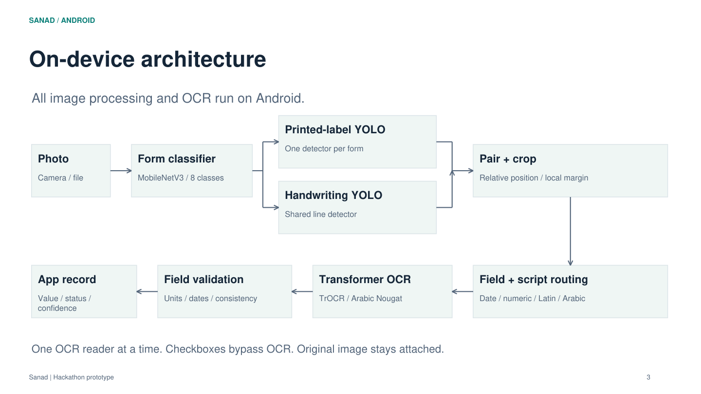

# Sanad

**The APK alone is not enough. You must import the model pack.**

1. Download `Sanad-v0.2.0-judge-kit.zip` (about 3 GB). The download link will be added here after upload.
2. Extract **this ZIP**. It contains `Sanad-v0.2.0.apk`, `Sanad-models-v1.zip`, and `README.txt`.
3. On a **64-bit Android phone (Android 8 or newer)**, open the APK and allow installation from your file manager. Install Sanad.
4. Copy `Sanad-models-v1.zip` to the phone's **Downloads** folder. Open **Sanad → Settings (top right) → Import model pack** and select that ZIP.
5. Keep Sanad open until it says **Models ready**.
6. Choose a registry image file when prompted. Use **Saved records** to reopen saved results.

## Results

**Organizer benchmark:** 80 supplied pages. These are organizer provided synthetic samples, separate from our generated training data.

| Extraction metric | Result |
|---|---:|
| Form classification | 97.5% (78/80 pages) |
| Field value exact match | 73.5% (3,458/4,705) |
| Field value match ignoring case, accents, punctuation and spacing | 80.1% (3,770/4,705) |

Form accuracy.

| Form | Normalized field match |
|---|---:|
| Pregnancy/postpartum monitoring | 70.5% |
| Identification and history | 84.5% |
| Current pregnancy | 78.1% |
| Labor and delivery | 87.4% |
| Early postpartum — mother | 83.2% |
| Early postnatal — newborn | 90.0% |
| Late postpartum — mother | 66.9% |
| Late postnatal — newborn | 87.3% |

**OCR:** date reader **94.8% exact match / 1.03% character error rate** on 600 samples; numeric reader **78.4% / 4.74%** on 900 samples.

**Android measurements:** one complete organizer sample took **37.016 seconds**, process memory reached **~0.91 GB**, and model storage is **2.94 GB**. 

## What we built

Android app that reads eight maternal/newborn paper forms offline and saves structured records with the original image, field status and confidence.

We removed handwriting objects from the supplied PDF, rendered new English/French/Arabic values in 18 handwriting fonts, and added rotation, blur, noise and JPEG degradation. Labels are saved as CSV/JSONL.

We trained form/script classifiers and YOLO label/handwriting detectors, fine-tuned TrOCR for dates and numbers, and exported the models to ONNX. Android runs one OCR reader at a time. Field rules validate units, dates, ranges and consistency. Records are encrypted locally and can sync over USB.

[Build/install](android-app/README.md) · [Slides](vision_pipeline/presentation/Sanad_pitch.pptx) · [Demo](demo/form01/Sanad-form-1-demo-with-form.mp4)
